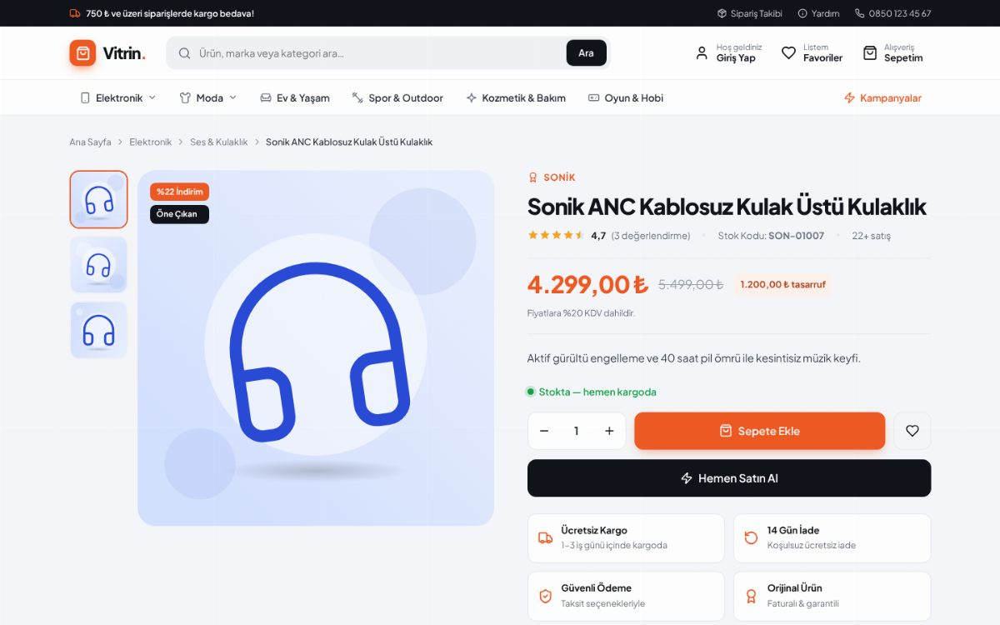
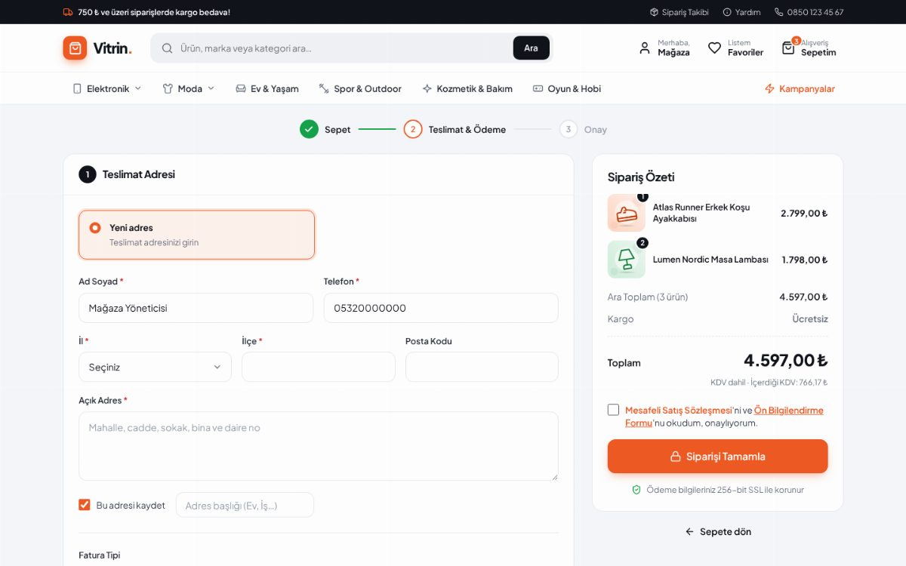
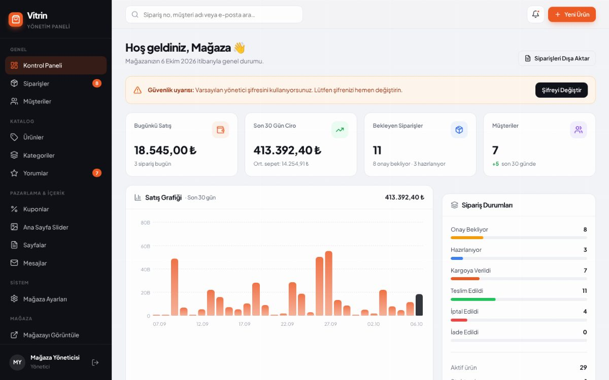
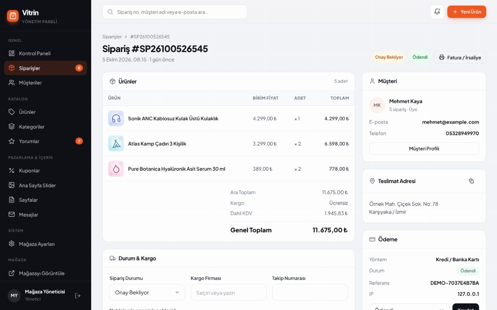

# Vitrin — Profesyonel E-Ticaret Scripti

Modern tasarımlı, kurulumu kolay, **bağımlılıksız PHP 8** e-ticaret yazılımı.
Ürün yönetimi, stok takibi, üyelik sistemi, sepet, kupon, çoklu ödeme yöntemi, sipariş takibi ve
tam donanımlı bir yönetim paneliyle kutudan çıktığı gibi satışa hazırdır.


| Ürün detay | Ödeme |
|---|---|
|  |  |

| Yönetim paneli | Sipariş yönetimi |
|---|---|
|  |  |

---

## İçindekiler

- [Özellikler](#özellikler)
- [Gereksinimler](#gereksinimler)
- [Hızlı Başlangıç (yerel)](#hızlı-başlangıç-yerel)
- [Sunucuya Kurulum](#sunucuya-kurulum)
- [Yapılandırma](#yapılandırma)
- [Demo Hesaplar](#demo-hesaplar)
- [Sanal POS Entegrasyonu](#sanal-pos-entegrasyonu)
- [Proje Yapısı](#proje-yapısı)
- [Güvenlik](#güvenlik)
- [Canlıya Almadan Önce Kontrol Listesi](#canlıya-almadan-önce-kontrol-listesi)

---

## Özellikler

### 🛍️ Mağaza (vitrin)
- **Modern, mobil uyumlu tema** — tamamen responsive, mobil menü, yapışkan başlık
- **Ana sayfa:** otomatik geçişli slider, kampanya kartları, kategori vitrinleri, öne çıkanlar, fırsat ürünleri, yeni gelenler, çok satanlar, geri sayımlı kampanya şeridi
- **Ürün listeleme:** kategori ağacı, marka / fiyat aralığı / stok / indirim filtreleri, 6 farklı sıralama, sayfalama
- **Canlı arama:** yazarken ürün önerileri (klavye ile gezinme destekli)
- **Ürün detay:** görsel galerisi + yakınlaştırma, indirim oranı ve tasarruf tutarı, stok durumu (*Stokta / Son X ürün / Tükendi*), teknik özellik tablosu, puanlı müşteri yorumları, benzer ürünler, Schema.org (SEO) verisi
- **AJAX sepet:** sayfa yenilenmeden sepete ekleme, mini sepet, adet güncelleme, ücretsiz kargo ilerleme çubuğu
- **Kupon sistemi:** yüzde veya sabit tutar, minimum sepet, kullanım limiti, tarih aralığı
- **Favoriler (istek listesi)**
- **Ödeme adımı:** kayıtlı adres seçimi / yeni adres, bireysel / kurumsal fatura, sözleşme onayı
- **3 ödeme yöntemi:** Kredi kartı (canlı kart önizlemeli), Havale/EFT (IBAN listesi + kopyala), Kapıda ödeme (+hizmet bedeli)
- **Sipariş takibi:** üyeler için zaman çizelgesi, misafirler için sipariş no + e-posta ile sorgulama
- **Kurumsal sayfalar:** Hakkımızda, Mesafeli Satış Sözleşmesi, KVKK, İade, SSS (panelden düzenlenebilir)
- **İletişim formu** (bot korumalı) ve **e-bülten** aboneliği

### 👤 Üyelik
- Kayıt / giriş / çıkış, **şifremi unuttum** (e-postayla süreli sıfırlama bağlantısı)
- Şifre güç göstergesi, kaba kuvvet koruması (15 dk'da 5 hatalı deneme)
- **Hesabım:** özet panel, siparişlerim (duruma göre filtre), sipariş detayı + iptal, adres defteri, profil & şifre değiştirme, favoriler

### ⚙️ Yönetim Paneli (`/admin`)
- **Kontrol paneli:** günlük/aylık ciro, 30 günlük satış grafiği, sipariş durumu dağılımı, son siparişler, en çok satanlar, kritik stok uyarıları
- **Ürünler:** ekleme/düzenleme/kopyalama/silme, çoklu görsel yükleme (sürükle-bırak, kapak seçimi), eski fiyat (indirim), maliyet & **kâr marjı hesaplama**, KDV oranı, SKU/barkod, stok ve kritik stok eşiği, durum (*Yayında / Taslak / Pasif*), öne çıkarma, SEO alanları, **toplu işlemler**
- **Kategoriler:** sınırsız alt kategori, ikon seçici, görsel, sıralama, gizleme
- **Siparişler:** durum yönetimi (*Onay Bekliyor → Hazırlanıyor → Kargoya Verildi → Teslim Edildi / İptal / İade*), kargo firması & takip no, müşteriye otomatik e-posta, ödeme durumu, dahili notlar, sipariş geçmişi, **yazdırılabilir fatura/irsaliye**, tarih/ödeme/durum filtreleri, **Excel (CSV) dışa aktarma**
- **Otomatik stok yönetimi:** sipariş verildiğinde stok düşer, iptal/iade edildiğinde geri eklenir (eşzamanlı siparişlerde eksi stoğa düşmez)
- **Müşteriler:** sipariş & harcama istatistikleri, adresler, hesabı askıya alma, yönetici yetkisi verme
- **Kuponlar, yorum onayı, slider, sayfalar, iletişim mesajları**
- **Mağaza ayarları:** mağaza bilgileri, logo, **tema ana rengi** (canlı önizleme), kargo ücreti & ücretsiz kargo limiti, ödeme yöntemlerini aç/kapat, banka hesapları, sosyal medya, SEO

---

## Gereksinimler

| | |
|---|---|
| PHP | **8.1 veya üzeri** |
| PHP eklentileri | `pdo`, `pdo_sqlite` **veya** `pdo_mysql`, `mbstring`, `fileinfo`, `openssl` (önerilir: `gd`, `intl`) |
| Veritabanı | **SQLite** (kurulum gerektirmez) veya **MySQL 5.7+ / MariaDB 10.3+** |
| Web sunucusu | Apache (mod_rewrite), Nginx, LiteSpeed veya PHP dahili sunucu |

Composer veya Node.js **gerekmez**.

---

## Hızlı Başlangıç (yerel)

```bash
git clone https://github.com/DeusAbi/E-Ticaret-Scripti.git
cd E-Ticaret-Scripti
php -S localhost:8000 -t public router.php
```

Tarayıcıda **http://localhost:8000** adresini açın. İlk açılışta veritabanı (SQLite) ve örnek veriler
**otomatik** olarak oluşturulur.

Komut satırından kurulum / sıfırlama:

```bash
php database/install.php            # kurulu değilse kurar
php database/install.php --fresh    # TÜM verileri silip yeniden kurar
php database/install.php --no-demo  # örnek ürün/sipariş olmadan kurar
```

---

## Sunucuya Kurulum

### 1. Dosyaları yükleyin
Tüm dosyaları sunucunuza yükleyin.

- **Önerilen:** Alan adınızın kök dizinini (document root) `public/` klasörüne yönlendirin.
- **Paylaşımlı hosting (cPanel / Plesk):** Dosyaları doğrudan `public_html` içine yükleyebilirsiniz.
  Kök dizindeki `.htaccess` tüm istekleri otomatik olarak `public/` klasörüne yönlendirir ve
  `app/`, `config/`, `storage/` gibi klasörlere erişimi engeller.

### 2. Yapılandırma dosyasını oluşturun
```bash
cp config/config.example.php config/config.php
```
`config/config.php` içinde site adresinizi, veritabanı ve e-posta bilgilerinizi girin
(ayrıntılar aşağıda).

### 3. Klasör izinleri
`storage/` ve `public/uploads/` klasörleri web sunucusu tarafından **yazılabilir** olmalıdır:
```bash
chmod -R 775 storage public/uploads
```

### 4. MySQL kullanacaksanız
Panelden boş bir veritabanı (`utf8mb4_unicode_ci`) oluşturun, bilgileri `config.php`'ye girin ve
siteyi açın — tablolar otomatik oluşturulur. (Alternatif: `php database/install.php`)

### 5. İlk giriş
`/giris` adresinden **admin@example.com / admin123** ile giriş yapın ve **şifreyi hemen değiştirin**
(Hesabım → Profil & Şifre). Ardından **Yönetim Paneli → Mağaza Ayarları**'ndan mağaza bilgilerinizi girin.

### Nginx örneği
```nginx
server {
    listen 80;
    server_name magazam.com;
    root /var/www/E-Ticaret-Scripti/public;
    index index.php;

    client_max_body_size 20M;

    location / {
        try_files $uri $uri/ /index.php?$query_string;
    }

    location ~ \.php$ {
        include fastcgi_params;
        fastcgi_pass unix:/run/php/php8.3-fpm.sock;
        fastcgi_param SCRIPT_FILENAME $realpath_root$fastcgi_script_name;
    }

    location ^~ /uploads/ {
        location ~ \.php$ { deny all; }
    }

    location ~ /\. { deny all; }
}
```

---

## Yapılandırma

`config/config.php`:

| Anahtar | Açıklama |
|---|---|
| `app.url` | Sitenizin tam adresi (e-postalardaki bağlantılar için) |
| `app.debug` | Geliştirmede `true`; **canlıda mutlaka `false`** |
| `db.driver` | `sqlite` veya `mysql` |
| `db.*` | MySQL bağlantı bilgileri |
| `mail.driver` | `log` (storage/logs/mail.log'a yazar), `mail` (PHP mail()) veya `smtp` |
| `mail.host/port/username/password/encryption` | SMTP bilgileri (Gmail, Yandex, Office365, hosting SMTP vb.) |
| `payment.gateway` | `demo` (gerçek tahsilat yapmaz) — bkz. Sanal POS entegrasyonu |
| `seed_demo_data` | İlk kurulumda örnek veriler oluşturulsun mu |

Mağaza adı, iletişim bilgileri, renk, kargo ücretleri, ödeme yöntemleri ve banka hesapları
**Yönetim Paneli → Mağaza Ayarları** üzerinden yönetilir.

---

## Demo Hesaplar

| Rol | E-posta | Şifre |
|---|---|---|
| Yönetici | `admin@example.com` | `admin123` |
| Müşteri | `demo@example.com` | `demo123` |

Demo kuponlar: `HOSGELDIN10` (%10), `INDIRIM150` (1.500 ₺ üzeri 150 ₺), `YAZ25` (2.500 ₺ üzeri %25)

Demo sanal POS test kartları:
- `4242 4242 4242 4242` → başarılı ödeme
- `4000 0000 0000 0002` → banka reddi

---

## Sanal POS Entegrasyonu

Kart ödemeleri `App\Payment\PaymentGatewayInterface` arayüzü üzerinden yapılır. Varsayılan
`DemoGateway` gerçek tahsilat yapmaz ve **kart bilgileri hiçbir zaman veritabanına kaydedilmez.**

iyzico, PayTR, Param, Sipay veya bankanızın sanal POS'unu eklemek için:

1. `app/Payment/` altında arayüzü uygulayan bir sınıf oluşturun:
   ```php
   namespace App\Payment;

   final class IyzicoGateway implements PaymentGatewayInterface
   {
       public function name(): string { return 'iyzico'; }

       public function charge(array $order, array $card): PaymentResult
       {
           // Sağlayıcının API'sini çağırın ($order['total'], $order['order_no'] ...)
           // Başarılıysa: return PaymentResult::ok($islemReferansi);
           // Hatalıysa:   return PaymentResult::fail('Hata mesajı');
       }
   }
   ```
2. `app/Payment/Gateway.php` içindeki `match` ifadesine ekleyin: `'iyzico' => new IyzicoGateway(),`
3. `config/config.php` → `'payment' => ['gateway' => 'iyzico']`

> 3D Secure gerektiren sağlayıcılarda, `CheckoutController::place()` içindeki kart akışını sağlayıcının
> yönlendirme/callback modeline göre uyarlamanız gerekir.

---

## Proje Yapısı

```
├── app/
│   ├── Controllers/          # Mağaza controller'ları
│   │   └── Admin/            # Yönetim paneli controller'ları
│   ├── Core/                 # Router, Database, Auth, Session, CSRF, Validator, Upload, Mailer...
│   ├── Payment/              # Sanal POS arayüzü ve demo sağlayıcı
│   ├── Services/             # İş mantığı: Cart, Order, Product, Category, Coupon, Pricing...
│   ├── Views/                # PHP şablonları (layouts, partials, mağaza ve admin görünümleri)
│   ├── bootstrap.php
│   ├── helpers.php
│   └── routes.php            # Tüm URL tanımları
├── config/config.example.php
├── database/
│   ├── schema.sqlite.sql
│   ├── schema.mysql.sql
│   └── install.php           # CLI kurulum aracı
├── public/                   # Web kök dizini
│   ├── assets/css|js|img
│   ├── uploads/              # Yüklenen görseller
│   └── index.php             # Front controller
├── storage/                  # SQLite veritabanı, loglar
└── router.php                # PHP dahili sunucusu için yönlendirici
```

---

## Güvenlik

- Tüm formlarda **CSRF** koruması
- Tüm SQL sorgularında **hazırlanmış ifadeler** (SQL injection koruması)
- Tüm çıktılarda HTML kaçışlama (XSS koruması)
- `password_hash` (bcrypt) ile şifreleme, girişte oturum kimliği yenileme
- Giriş denemelerinde hız sınırlama
- Görsel yüklemelerinde MIME + içerik doğrulaması, rastgele dosya adları, `uploads/` içinde betik çalıştırma engeli
- Açık yönlendirme (open redirect) koruması
- Şifre sıfırlama jetonları veritabanında hash'li saklanır, 60 dakika geçerlidir
- Güvenlik başlıkları (`X-Frame-Options`, `X-Content-Type-Options`, `Referrer-Policy`)
- Sipariş/adres işlemlerinde sahiplik kontrolü
- Kart bilgileri saklanmaz

---

## Canlıya Almadan Önce Kontrol Listesi

- [ ] `config/config.php` → `app.debug = false`, `app.url` doğru
- [ ] Yönetici şifresi değiştirildi (veya yeni yönetici oluşturulup demo hesap silindi)
- [ ] `php database/install.php --fresh --no-demo` ile temiz kurulum (örnek veriler istenmiyorsa)
- [ ] SSL sertifikası kuruldu, `public/.htaccess` içindeki HTTPS yönlendirmesi açıldı
- [ ] SMTP ayarları yapıldı (`mail.driver = smtp`) ve test e-postası gönderildi
- [ ] Gerçek sanal POS entegrasyonu yapıldı veya kart ödemesi panelden kapatıldı
- [ ] Mağaza ayarlarında şirket ünvanı, vergi bilgileri, MERSİS, adres ve banka hesapları güncellendi
- [ ] Mesafeli Satış Sözleşmesi, KVKK ve İade metinleri hukuk danışmanınızca kontrol edildi
- [ ] `storage/` ve `public/uploads/` için düzenli yedekleme planlandı

---

## Lisans

Bu proje sahibine aittir. Kullanım ve dağıtım koşulları için depo sahibiyle iletişime geçin.
